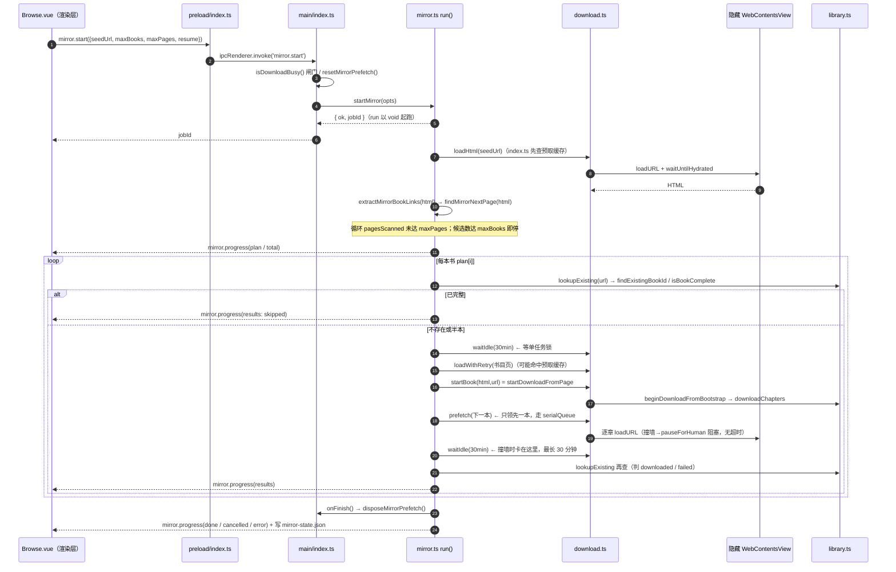

# 整站镜像在主进程里是怎么跑起来的

> 只读解释文档。范围：`src/main/mirror.ts`（主体）、`src/main/index.ts`（运行时装线与 IPC）、`src/main/download.ts`（单任务锁 / 撞墙暂停）、`src/main/mirror.test.ts`、`docs/ipc-contract.md`、`scripts/mirror-e2e.mjs`、`src/renderer/pages/Browse.vue`、`src/preload/index.ts`。
> **行号基准**：`HEAD = 015520f`（`mirror.ts` 415 行 / `download.ts` 1853 行 / `index.ts` 2546 行）。本报告不修改任何产品代码。
>
> **工作区里有别人正在改这三个文件（未提交，不是本报告产生的）**：一组「撞墙感知」改造——`mirror.ts` 新增 `MIRROR_WAIT_SLICE_MS` / `MIRROR_WAIT_LIMIT_MS` / `waitForDownloadSlot()`、`MirrorDeps.waitIdle(sliceMs)` 与 `blockedReason`，`download.ts` 新增 `getPausedForHuman`（+4 行），`index.ts:556-565` 改成按时间片等锁并回传撞墙原因，设计稿在 `.multi-agent/evidence/mirror-wall-design-2026-10-20.md`。**本文描述的是已提交版本（`015520f`）的实际行为**，也就是现在构建/打包跑的那套；未提交版本正在修 Gotcha 1 与 Gotcha 2 说的问题。读未提交版本时行号会整体位移（`download.ts` 自 299 起 +4，`mirror.ts` 自 21 起 +2 且 `run()` 被重排），所有引用都带符号名，行号对不上时按符号名检索。

---

## Overview

整站镜像不是一个独立的抓取器，而是**在既有「下载本书」通道外面套的一层批量调度器**：它只负责三件事——①从列表页抽书目链接并跟同源「下一页」；②逐本把「这一本的目录页 HTML + 地址」交给下载层（`startDownloadFromPage`）；③用书库做真值对账（已完整就跳过、没完整就补章）。正文抓取、隐藏视图、水合等待、撞墙暂停全部复用 `download.ts`，因此镜像**不持有自己的锁**，它借用下载层的「同一时刻只有一个 `active` 任务」这条不变量。

关键分界：

| 关注点 | 归属 | 落点 |
|---|---|---|
| 书目发现 / 翻页 / 上限 / plan / 状态文件 | 镜像层 | `src/main/mirror.ts` |
| 运行时装线、IPC、预取视图、锁的超时值 | 主进程外壳 | `src/main/index.ts` |
| 单任务锁、逐章下载、撞墙暂停、取消传播 | 下载层 | `src/main/download.ts` |
| 入口与进度抽屉 | 渲染层 | `src/renderer/pages/Browse.vue` |

设计上有一条硬约束值得先记住：**镜像的 `waitIdle` 有 30 分钟上限，但这个上限管的是「整本书下载完」而不是「下载是不是卡住了」**（见 Gotchas 第 1 条）。这是全文最需要警惕的一处。

---

## Key Concepts

**1. 镜像层与下载层是依赖注入关系，不是 import 关系。**
`mirror.ts` 不 import `download.ts`，而是由 `index.ts` 的 `configureMirrorRuntime()`（`index.ts:541-602`）通过 `setMirrorDeps()`（`mirror.ts:143-145`）注入 `MirrorDeps`（`mirror.ts:35-49`）。好处是 `mirror.test.ts` 能用假 deps 跑完整调度；代价是**运行时行为（超时值、预取、取消语义）全在 `index.ts:541-581` 这一段闭包里，看 `mirror.ts` 是看不出来的**——尤其 `waitIdle: () => waitForIdle(30 * 60_000)`（`index.ts:559-560`）。

**2. 「单任务锁」不是一个 mutex，而是下载层的一条隐式不变量：`active.size > 0` 就拒绝新下载。**
`download.ts:144` 的 `active: Map<string, ActiveDownload>` 就是锁本体；`startDownloadFromPage`（`download.ts:911-913`）、`startDownload`（`924-926`）、`checkUpdate`（`1613-1615`）都在开头用 `active.size > 0` 直接返回中文拒绝。镜像因此**不能"拿锁"**，只能 `waitIdle()` 空转等它变空（`download.ts:289-297`，20ms 轮询）。这也是为什么 `waitForIdle` 的失败文案是英文的 `download did not become idle`——它是给开发者看的（`download.ts:293`）。

**3. 「已入库」的唯一真值是书库，不是镜像日志。**
`MirrorDeps.lookupExisting` 在 `index.ts:562-577` 实现：先 `findExistingBookId(normalizeBookHost(host), url)`（`library.ts:152-157`，按 bookId 变体匹配 www / 非 www / 目录跟进后的地址），再退回 `canonicalizeUrl(sourceUrl)` 与 `listBooks()` 比对。`complete` 由 `isBookComplete`（`library.ts:563-570`）给：所有章节 `ready` 或 `empty` 即完整。`mirror.test.ts:155-179` 把「完整跳过、半本仍下」钉成契约。

**4. 书目地址的去重口径用 `canonicalizeUrl`，翻页地址的口径用原始 URL。**
两处刻意不一致：书目去重用规范化值（`mirror.ts:96`、`mirror.ts:272`），因为同一本书常有 `#comments`、尾斜杠、参数差异；翻页去重用 `new URL(next).toString()`（`mirror.ts:262`、`279`），因为 `canonicalizeUrl` 会删掉 `page` 参数——用规范化值做翻页身份会把第 2 页当成第 1 页，代码注释写在 `mirror.ts:124` 和 `261`。

**5. 「撞墙暂停」是下载层的主动停等，不是抛错。**
同类墙（`NeedLogin` / `Paywall` / `Intercepted`，`download.ts:162-164`）连续撞 `WALL_PAUSE_STREAK = 3` 章（`download.ts:106-110`）后，`downloadPass` 调 `pauseForHuman`（`download.ts:424-436`）发 `download.blocked` 并 `await waitWhilePausedForHuman(dl)`（`download.ts:439-462`）。这个 Promise **没有任何超时**，只由两件事解开：`resumeUnblock` → `notifyHumanResumed`（`download.ts:1597-1607`、`464-469`），或 `cancelDownload` → `cancelWaiters` 里的 `onCancel`（`download.ts:454-458`、`1557-1565`）。

**6. 预取视图是独立 WebContents，只能串行导航。**
`index.ts:486-490` 建 `mirrorPrefetchView` + `enqueueMirrorPrefetch = createSerialQueue()`；`serialQueue.ts:1-21` 的注释说明了原因：一个 `WebContents` 只有一条导航，两次 `loadURL` 叠在一起会把先发起的那次 abort 掉，而 `loadAndGetHtml` 把 `ERR_ABORTED` 当正常结束吞掉（`download.ts:684-690`），于是会读到错页。

---

## How It Works

### 1. 从「整站镜像」按钮到书目被发现

1. **渲染层**：`Browse.vue:1924-1971` 是抽屉模板，「开始镜像」`@click="startMirrorJob()"`（`1938`）、「继续上次」`startMirrorJob(true)`（`1939`）、「取消镜像」`cancelMirrorJob`（`1940`）。打开抽屉走 `openMirror()`（`Browse.vue:1301-1311`），先 `window.api.mirror.state()` 取上一次结果回填 `mirrorProgress`。
2. **启动**：`startMirrorJob(resume)`（`Browse.vue:1313-1357`）决定 `seedUrl`——续跑时**固定用上次保存的 `seedUrl`**，不用当前页（`1316-1319`，注释说明了原因）；本地点「开始」时再乐观写入一个 `status: 'running'` 的本地 `MirrorProgress`（`1337-1348`），随后由 `mirror.progress` 事件覆盖。
3. **preload**：`preload/index.ts:196-206` 白名单——`mirror.start` / `mirror.cancel` / `mirror.state` 三个 invoke，加一个 `mirror.onProgress` 订阅；订阅在 `Browse.vue:1455` 接到 `mirrorProgress.value = progress`。
4. **IPC**：`index.ts:1264-1279`。`mirror.start` 先做两道闸：`isDownloadBusy()`（`1265`，`download.ts:299-301`，含 `checkAllRunning`）与 `resetMirrorPrefetch()`（`1267`）；`seedUrl` 省略时取当前浏览页 URL（`1266`）。然后调 `startMirror`。
5. **镜像层**：`startMirror`（`mirror.ts:169-218`）校验 deps / 是否已有 running 任务 / `seedUrl` 是否 http(s) / 夹紧 `clampMirrorOptions`（`129-136`：`maxBooks` 1–50 默认 10，`maxPages` 1–10 默认 3），重置 `cancelled` 与 `currentBookId`（`175-176`），造 `job`，然后 **`void run(...)` 起跑并立刻返回 jobId**（`216-217`）——所以 IPC 是"启动即返回"，进度只走事件与 `mirror.state`。
6. **发现**：`discover()`（`mirror.ts:254-282`）从 `job.seedUrl` 开始串行扫描，每页 `loadWithRetry`（`238-252`，最多 2 次、失败退避 400ms，且失败后若 `cancelled` 就不再重试）→ 交给 `extractMirrorBookLinks`（`58-102`）取书目 → 再 `findMirrorNextPage`（`105-127`）取下一页。返回 `MirrorPlanItem[]` 写进 `job.plan`（`289-292`），并 `publish()`（`228-236`：先 `emit` 再 `saveState`，落盘失败不影响任务）。

### 2. 书目发现、翻页、去重与上限

- **打分与过滤**（`extractMirrorBookLinks`，`mirror.ts:58-102`）：
  - 硬过滤：非 `http(s)`、跨源（`url.origin !== origin`）、锚点 / `javascript:` / `mailto:`、标题长度不在 2–60、标题命中 `NEXT_TEXTS`（`53`）、`ASSET_EXT` 资源后缀（`54`）、`NON_BOOK` 黑名单（`52`：login/search/rank/shelf/tag/category/page 等）、以及与当前页规范化后相同的地址。
  - 打分：`BOOK_SEGMENT` 命中 `/book|novel|info|read|txt|article|story|n|b/` +3（`83`）、路径里有数字段 +1（`84`）、祖先在 `li/.item/.book/.list/.result/tr` 里 +1（`85`）。
  - **回退规则**（`88-89`）：只要**有一条**候选得分 > 0，就整体丢弃所有 0 分候选；全为 0 时才退回全量。这是「看起来像书」的启发式，会漏书（Gotchas 第 7 条）。
  - 结果按 `score desc, DOM 顺序` 排，再用 `canonicalizeUrl` 去重（`90-100`）。
- **翻页**（`findMirrorNextPage`，`105-127`）：`rel="next"` 优先，否则文本命中 `NEXT_TEXTS`（`53`，中英「下一页 / next / › / » / > / >>」）；必须是同源、非锚点、非自身；比较用原始 URL（`125`）。
- **上限与提前停**（`discover`，`254-282`）：`while (next && job.pagesScanned < maxPages && !cancelled)`（`259`）；每页累加 `job.pagesScanned`（`270`）；**当前候选数一旦 `>= maxBooks` 就停止翻页**（`277`），最后 `slice(0, maxBooks)`（`281`）。`seenBooks` / `seenPages` 都是 `discover` 内的局部 `Set`（`256-257`），**跨页去重、跨任务不去重**（跨任务靠书库对账）。
- **页级容错**：只有第 0 页加载失败会抛出（`267`）并让整任务 `status: 'error'`；第 2 页起失败只是静默 `break`（`268`），书目少也不提示。
- **零结果**：`total === 0` 时任务以 `status: 'error'` + 中文提示结束（`293-298`），契约写在 `mirror.test.ts:310-318`。

### 3. 逐本调度：锁、跳过、续跑

主循环在 `run()`（`mirror.ts:284-415`），每本书一轮：

1. **顶部取消检查**（`307`）→ 写 `job.currentTitle` 并 `publish`（`308-309`，抽屉里「正在下载：《书名》」即来自这里，`Browse.vue:1954`）。
2. **第一次对账**（`311-322`）：`lookupExisting(item.url)`；`complete` 就 `skipped += 1` 并 `continue`——**不加载书目页、不碰下载层**（契约：`mirror.test.ts:155-167`）。
3. **等锁**（`await d.waitIdle()`，`328`）：注释写清了目的——等用户手点的「下载本书」结束，避免把锁的拒绝记成失败。
4. **第二次对账**（`329-336`）：等锁期间别的下载可能刚好把这本书下完，所以再查一次；`complete` 则记 `skipped`。
5. **下载这本书**（`338-358`）：`loadWithRetry(item.url)` 取书目页 HTML（**会先命中预取缓存**，见第 5 节）→ `d.startBook(html, url)` → `startDownloadFromPage`（`download.ts:906-920`）→ `startFromExtractedHtml`（`875-904`，必要时 `followCatalogIfNeeded`、补抓分页目录续页）→ `beginDownloadFromBootstrap`（`1086-1150`）→ `downloadChapters`（`1152-1174`）。
6. **记 bookId 并预取下一本**（`341-344`）：`currentBookId = started.bookId`；`d.prefetch?.(pending[index+1].url)`——**只领先一本**。
7. **等这本下完**（`345` `await d.waitIdle()`）→ 清 `currentBookId`（`346`）→ 若已取消则 `break` 且**不记结果**（`347-348`，续跑幂等重试，契约 `mirror.test.ts:204-247`）。
8. **以书库为准判成败**（`349-358`）：再 `lookupExisting`，`complete` 记 `downloaded`，否则记 `failed` + 「下载结束但书未完整，可继续重试」。**下载层"跑完"不代表整本完整。**
9. **锁拒绝的分支**（`359-361`）：`startBook` 返回 `ok:false` 但带 `bookId`（下载层认出是同一本已完整并拒绝重下，`beginDownloadFromBootstrap:1126-1133`）→ 按 `skipped` 记。
10. **`finally` 清尾**（`379-387`）：若 `currentBookId` 仍在（说明抛错 / 超时，下载可能还占着锁）→ `cancelBook(stuck)` + `await d.waitIdle().catch(()=>{})`，注释：「别让下一本全部撞锁」。
11. 计数、`publish`（`389-395`）。

**收尾**（`398-414`）：`status = cancelled ? 'cancelled' : 'done'`；异常路径 `catch` 记 `error` + 消息（`402-406`）；`finally` 无条件 `d.onFinish?.()` → `disposeMirrorPrefetch()`（`index.ts:530-539`，`webContents.close()` + 置 `mirrorPrefetchClosed = true`）。契约测试：`mirror.test.ts:275-295`（恰好一次，取消也调）、`181-202`（单本 `waitIdle` 抛错不终止整批）。

**跳过 / 续跑**：
- 跳过 = 书库对账（`complete`），不是"上次下过"。半本仍交给下载层补（`beginDownloadFromBootstrap` 会合并章节、只下 `chapterNeedsDownload` 的章，`download.ts:1101-1126`）。
- 续跑（`mirror.ts:178-201`）：`resume: true` 时要求 `current` 存在、`canonicalizeUrl(previous.seedUrl)` 与本次相同（`180`）、`previous.plan` 非空（`182`）；然后**重置 `results/done/failed/skipped/currentTitle/message/interrupted` 但沿用 `plan`**（`185-197`，注释：「不沿用上次的 results，否则同一条目会重复计数」），新 `jobId`，`run(job, maxBooks, maxPages, previous.plan)`。
- 状态文件：`saveState` 写 `<userData>/mirror-state.json`（`index.ts:478-480`、`579`）。启动时 `configureMirrorRuntime` 读回（`582-598`）：**遗留的 `status === 'running'` 被降级成 `cancelled` + `interrupted: true` + 「上次镜像任务被中断，可继续」**（`585-594`），界面据此给「继续上次」（`Browse.vue:237-244` 的 `mirrorCanResume`：`failed > 0 || results.length < plan.length`）。

### 4. 撞墙 / 登录墙时下载层发生什么，镜像等多久

**下载层内部**（`download.ts`）：

- 单章判定失败为 `Paywall` / `NeedLogin` / `Intercepted` → `downloadPass` 累计 `wallStreak`（`1200-1207`）；`RateLimited` 走另一条 `rateStreak >= 3` 提前 `stopped`（`1209-1218`）。
- 同类墙连撞 3 章（`WALL_PAUSE_STREAK`，`110`、`1223`）→ `pauseForHuman`（`424-436`）：写入 `dl.pausedForHuman`、发 `download.blocked`（`416-422`，payload 类型 `types.ts:229-237`）、`emitProgress` 让进度变 `awaitingHuman`（`380-385`）。
- 然后 `await waitWhilePausedForHuman(dl)`（`1226`）——**无超时的 Promise**（`439-462`）。此时 `dl` 仍在 `active` 里，`downloadChapters` 的 `finally`（`1152-1174`，`1171` `active.delete`）还没执行，所以**单任务锁一直被占着**。
- 解开只有两条路：用户点「我已处理好，继续下载」→ `resumeUnblock`（`1597-1607`）→ `notifyHumanResumed` → 唤醒 → `requeueWallFailedChapters`（`475-497`，把墙章退回 `pending`，同章最多重排 `WALL_REQUEUE_LIMIT = 2` 次，`167`）→ 再来一轮 `downloadPass`；或者 `cancelDownload`（`1557-1565`）→ `notifyLoadCancelled` 唤醒 `cancelWaiters` 里的 `onCancel` → 抛「已取消」（`454-458`）。

**镜像侧**：镜像只看到 `waitIdle` 不返回。它**不知道在撞墙**——`MirrorProgress` 里没有任何"卡在哪一章/哪堵墙"的字段（`types.ts:261-282`），`mirror.progress` 也不含 `pausedForHuman`。撞墙提示只发到 `download.blocked`，而**唯一的消费者是 `Library.vue:1063-1066`**（`message.warning` + `blockedByBook`），`Browse.vue` 里没有 `onBlocked` 订阅（全库 grep 只有 `Library.vue` 与它的契约测试）。所以用户在浏览页看到的只是镜像停在「正在下载：《X》」不动。

### 5. 预取视图与 serialQueue 的并发约束

- 预取视图：`index.ts:486-506`，`novelSession()`（与浏览/下载共用 `persist:novel` 登录态）、不可见、坐标 `-2400,-2400`。与下载的隐藏视图（`download.ts:303-325`）**是两个 WebContents**，所以「下载这一本」和「抓下一本的书目页」能并行——但**下载本身仍串行**。
- 串行化：`prefetchMirrorPage`（`index.ts:508-522`）把每个预取包进 `enqueueMirrorPrefetch(() => loadPageHtmlWithView(getMirrorPrefetchView(), url))`（`510-514`）。`createSerialQueue`（`serialQueue.ts:11-21`）用 `tail.then(task, task)`：前一个失败也继续下一个，每个调用拿到自己那次的结果。
- 消费：`loadHtml` 闭包（`index.ts:543-554`）先查 `mirrorPrefetchCache`，命中就 `await` 并**从缓存删除**（一次性），失败则回落到 `loadPageHtml(url)`（下载隐藏视图）。
- 容量与生命周期：缓存最多 4 条，超出淘汰最老（`516-520`）；失败会自删（`521`）；`resetMirrorPrefetch()`（`525-528`）在新任务开始时 `clear()` 并重开 `mirrorPrefetchClosed = false`；`disposeMirrorPrefetch()`（`530-539`）关视图。窗口关闭时也会 `disposeMirrorPrefetch()`（`index.ts:644`）。
- 队列内任务的自我保护：排队期间任务可能已结束，此时 `mirrorPrefetchClosed` 为 true 就抛「镜像预取已关闭」而不是重建视图（`index.ts:511-512`）。
- 与下载层的隐性耦合：`loadAndGetHtml` 里有 `anyActiveCancelled()` 检查（`download.ts:715`），`waitForNavigationSettle` 也检查（`669`）。所以**只要有任何一本下载被标了 `cancelled` 且还没从 `active` 里删掉，镜像的页面加载就会抛「已取消」**（见 Gotchas 第 5 条）。

### 6. 时序图

---

## Where Things Live

| 符号 | 文件:行 | 职责 |
|---|---|---|
| `MIRROR_DEFAULT_MAX_BOOKS / MAX_BOOKS / DEFAULT_MAX_PAGES / MAX_PAGES` | `mirror.ts:17-20` | 10/50、3/10 |
| `MirrorDeps` | `mirror.ts:35-49` | 镜像层对外六件事：loadHtml / startBook / waitIdle / cancelBook / lookupExisting / prefetch / onFinish |
| `extractMirrorBookLinks` | `mirror.ts:58-102` | 同源书目抽取 + 打分 + 去重 |
| `findMirrorNextPage` | `mirror.ts:105-127` | 同源「下一页」 |
| `clampMirrorOptions` | `mirror.ts:129-136` | 参数夹紧 |
| 模块级状态 `deps / current / cancelled / currentBookId` | `mirror.ts:138-141` | 见 Gotchas 第 8 条 |
| `setMirrorDeps` / `setMirrorLastState` / `resetMirrorForTests` | `mirror.ts:143-157` | 装线 / 回填历史 / 测试复位 |
| `getMirrorState` / `cancelMirror` | `mirror.ts:159-167` | `{running,last}` / 取消 |
| `startMirror` | `mirror.ts:169-218` | 新建或续跑，`void run()` 起跑 |
| `publish` / `loadWithRetry` | `mirror.ts:228-252` | emit+落盘 / 2 次加载重试 |
| `discover` | `mirror.ts:254-282` | 翻页 + 去重 + 上限 |
| `run` | `mirror.ts:284-415` | 逐本调度主循环、收尾 |
| `mirrorStatePath` | `index.ts:478-480` | `userData/mirror-state.json` |
| 预取视图 / 缓存 / 队列 / reset / dispose | `index.ts:486-539` | 见第 5 节 |
| `configureMirrorRuntime` | `index.ts:541-602` | 注入 deps（含 30 分钟锁超时、lookupExisting）+ 读回状态文件并降级 `running` |
| IPC `mirror.start/cancel/state` | `index.ts:1264-1279` | 入口闸门 + 当前页兜底 seedUrl |
| `mirror` preload 白名单 | `preload/index.ts:196-206` | start/cancel/state/onProgress |
| 镜像抽屉状态与动作 | `Browse.vue:220-244`、`1301-1365`、`1455`、`1924-1971` | 本地进度、续跑判据、订阅 |
| `waitForIdle` / `isDownloadBusy` | `download.ts:289-301` | 单任务锁的观察口（15s 默认 / 镜像传 30min） |
| `pauseForHuman` | `download.ts:424-436` | 写 `pausedForHuman` + 发 `download.blocked` |
| `waitWhilePausedForHuman` / `notifyHumanResumed` | `download.ts:439-469` | 无超时停等 / 唤醒 |
| `requeueWallFailedChapters` | `download.ts:475-497` | 墙章退 pending（每章上限 2 次） |
| `withCancel` / `interruptibleDelay` | `download.ts:552-581`、`499-517` | 取消传播到在途等待 |
| `loadAndGetHtml` / `loadPageHtml` / `loadPageHtmlWithView` | `download.ts:705-765` | 页面加载（预取复用同一套水合与探测） |
| `startDownloadFromPage` | `download.ts:906-920` | 镜像的唯一入口 |
| `beginDownloadFromBootstrap` / `downloadChapters` | `download.ts:1086-1174` | 建/合并书籍、跑章节 |
| `downloadPass` 撞墙分支 | `download.ts:1223-1234` | 3 连撞 → pause → 停等 |
| `cancelDownload` / `resumeUnblock` | `download.ts:1557-1565`、`1597-1607` | 取消 / 人工续跑 |
| 契约 | `docs/ipc-contract.md:191-209` | 频道表、发现、跳过、串行、续跑、已知边界 |
| 单测契约 | `mirror.test.ts:95-328` | 抽取/翻页/夹紧/跳过/半本/超时隔离/续跑/预取/onFinish |
| E2E | `scripts/mirror-e2e.mjs:139-174` | 真 Electron + 本地夹具站，两轮（首轮入库、次轮全跳过） |

---

## Gotchas

**1. 「撞墙时镜像等 30 分钟」——属实（`015520f`），而且比"等"更狠：到点不是放弃等待，是取消这本。★**
证据链：`index.ts:559-560` 注入 `waitIdle: () => waitForIdle(30 * 60_000)`；`download.ts:289-297` 的 `while (active.size > 0 || runningJobs.size > 0)` 在 30 分钟后 `throw new Error('download did not become idle')`。撞墙时 `pauseForHuman` → `waitWhilePausedForHuman` 无超时（`download.ts:439-462`），`active` 条目要等 `downloadChapters` 的 `finally` 才删（`download.ts:1171`），所以 `active.size` 一直是 1 → 镜像卡在 `mirror.ts:345` 的 `await d.waitIdle()` 上，直到 30 分钟超时 → `catch`（`372-378`）把这本记成 `failed`，消息是**英文** `download did not become idle`（直接进抽屉的 `mirror-reason`，`Browse.vue:1965`）→ `finally`（`379-387`）再 `d.cancelBook(stuck)` 把还在暂停的下载**杀掉**，并再等一次 `waitIdle`（这次会很快返回，但**又是一个全新的 30 分钟预算**，因为超时值是每次调用给的，`index.ts:560`）。
两个推论必须写清：
- 用户如果在这 30 分钟内到书库点「我已处理好，继续下载」（`Library.vue:1243` → `resumeUnblock`），`waitIdle` 会提前返回，镜像正常继续——所以 30 分钟是**上限不是固定值**。
- 但这 30 分钟**不是停滞检测**：一本正常但很长的书（`download.ts:70-74`：standard 档每章 600ms 间隔，加每章 1–2s 加载，1000 章 ≈ 35 分钟）同样会超时被记 `failed` 并被取消。代码注释自己也承认这是"只防死等"（`index.ts:559`），但它防不住"合法的慢"。
- 同一段风险也存在于**开跑前**那次 `waitIdle`（`mirror.ts:328`）：若用户手点的某本下载正在撞墙暂停，镜像还没开始第一本就先空等 30 分钟，然后把它想下的那本记成 `failed`（尽管根本没碰过它）。
- 契约文档已把这条写成「已知边界」（`docs/ipc-contract.md:204`），选择是**不自动解决**，只建议手动取消。

**2. 「取消在等待锁期间是否生效」——不生效，而且会多下一本书（`015520f`）。★**
`cancelMirror`（`mirror.ts:163-167`）只做两件事：`cancelled = true`；**若 `currentBookId` 存在**才 `deps.cancelBook(currentBookId)`。而 `currentBookId` 只在 `startBook` 成功后赋值（`mirror.ts:341`），`startMirror` 开头（`176`）和每本结束后（`346`）都清成 `undefined`。于是：
- **在 `mirror.ts:328` 的 `waitIdle` 里取消**：`currentBookId` 为 `undefined` → 不调 `cancelBook` → 下载层**毫不知情**，`waitForIdle` 的 20ms 轮询循环里也没有任何 `cancelled` 检查（`download.ts:289-297`）→ 镜像只能等锁自己释放或 30 分钟超时。
- 更糟：锁释放/超时之后，**`328` 到 `339` 之间没有任何 `cancelled` 检查**（`329-338` 只做对账与加载），所以它还会把这一本 `startBook` 起来；唯一的取消点在下一次 `waitIdle` 之后（`348` `if (cancelled) break`，且该分支不写结果）。净效果：**用户点了取消，镜像仍会完整下完一本，然后才停在 `cancelled`**。
- **在 `mirror.ts:345` 的 `waitIdle` 里取消（含撞墙暂停中）**：此时 `currentBookId` 已设（`341`）→ `cancelBook` → `cancelDownload(bookId)`（`download.ts:1557-1565`）置 `dl.cancelled` 并 `notifyLoadCancelled()`（`255-258`：`wc.stop()` + 唤醒 `cancelWaiters`），`waitWhilePausedForHuman` 的 `onCancel`（`454-458`）抛「已取消」→ `downloadPass` 返回（`1227-1229`）→ `downloadChapters` `finally` 删 `active`（`1171`）→ 镜像的 `waitIdle` 返回 → `348` `break`。**这条路是有效的。**
- 发现阶段的取消（`discover`）：`while` 条件里有 `!cancelled`（`259`），`loadWithRetry` 只在**加载失败后**才看 `cancelled`（`247`）——在途的那次页面加载无法被镜像的 `cancelled` 打断（它只能被下载层的 `cancelWaiters` 打断）。
- 结论一句话：**取消只对"已在下载的那一本"生效，对"正在等锁"和"正在加载"不生效；契约文档 `docs/ipc-contract.md:206` 的「`mirror.cancel` 在书目之间生效」是准确的，但容易被读成"随时生效"。**

**3. 撞墙提示不会出现在镜像抽屉里，用户看到的是"卡住"。**
`download.blocked` 只由 `Library.vue:1063-1066` 消费；`Browse.vue` 没有 `onBlocked` 订阅，`MirrorProgress`（`types.ts:261-282`）也没有墙字段。镜像卡在 `waitIdle` 时抽屉只显示 `currentTitle` 与「镜像中」，到 30 分钟超时为止没有任何解释。反过来说，**用户要解除墙必须切到书库页**（`Library.vue:1240-1243` 的「打开这一章」/「我已处理好，继续下载」）。

**4. 锁是"先到先得"，镜像撞上别人的下载会把这本直接记失败，而不是重试。**
`startDownloadFromPage` 在 `active.size > 0` 时返回 `{ ok:false, message:'已有下载任务在进行中…' }`（`download.ts:911-913`）。镜像虽然先 `waitIdle`（`mirror.ts:328`），但存在竞态窗口：`waitIdle` 返回后、`startBook` 之前，用户点了「下载本书」。此时 `started.ok === false` 且 `bookId` 未定义 → 走 `mirror.ts:362-370` 记 `failed`，**不重试**。`mirror.start` 的 `isDownloadBusy()` 闸门（`index.ts:1265`）只挡住了"开跑时"，挡不住"跑的过程中"。

**5. 全局取消会误伤镜像的页面加载（跨任务残留）。**
`anyActiveCancelled()`（`download.ts:234-239`）遍历**所有** `active`，而 `loadAndGetHtml`（`715`）和 `waitForNavigationSettle`（`669`）都用它。只要有一本下载被取消且还没从 `active` 删掉，`mirror.ts:238-252` 的 `loadWithRetry` 会拿到「已取消」并只重试一次（`LOAD_ATTEMPTS = 2`，退避 400ms）；如果那次下载的收尾超过约 400ms，这一本的书目页加载就失败 → 记 `failed`。`notifyLoadCancelled`（`download.ts:255-258`）是**广播**，会把正在预取的镜像视图的 `loadURL` 也 `wc.stop()` 掉。

**6. 「跳过」的判据是 `isBookComplete`，而它把 `empty` 也算完整。**
`library.ts:563-570`：所有章节 `ready` 或 `empty` 即 `complete`。所以一本撞了墙、所有章节都被写成 `empty` 占位的书，镜像会认成"已入库完整"并永久跳过。这是有意的设计（空章不是可重下的失败），但排查"为什么这本没补"时要先看这个。

**7. 书目抽取会因"有一条像书的链接"而整体丢分。**
`mirror.ts:88-89`：`preferred = scored.some(score > 0)`；一旦成立，所有 0 分候选被丢弃。列表页里 `/book/` 链接只有几条、其余书籍链接是 `/12345/` 之类无特征路径时，**只会下那几条**。零特征站则会退回全量（契约 `mirror.test.ts:103-107`），代价是可能把非书链接当书。

**8. 跨任务残留的模块级可变状态清单。**

| 模块 | 状态 | 是否在任务间复位 | 残留风险 |
|---|---|---|---|
| `mirror.ts:138-141` | `deps` | 进程内不变 | 低 |
| `mirror.ts:138-141` | `current` | 每次 `startMirror` 覆盖（`198`/`215`） | 中：续跑、`mirror.state` 全靠它；`setMirrorLastState` 只在 `current?.status !== 'running'` 时写入（`147-150`），所以**若历史状态在某个任务 running 时被回填，会被静默丢弃** |
| `mirror.ts:138-141` | `cancelled` | 只在 `startMirror` 开头复位（`175`） | 高：它是"全局取消旗"，不是 per-job。旧 run 的循环若还在飞（例如卡在 `waitIdle`），新任务一开头把它清成 `false`，旧循环会"复活"继续下书。当前被 `current?.status === 'running'` 挡着（`171`）**才没出事**——因为 `cancelled` 之后 `current.status` 仍是 `running` 直到 `399`，新任务会被拒 |
| `mirror.ts:138-141` | `currentBookId` | 每本前/后清（`176`/`346`/`383`） | 高：`cancelMirror` 唯一的取消抓手，清早了取消就失效（见 Gotcha 2）；两轮任务重叠时会被互相覆盖 |
| `index.ts:486-490` | `mirrorPrefetchView` / `mirrorPrefetchClosed` / `mirrorPrefetchCache` | `resetMirrorPrefetch` 清缓存并重开（`525-528`），`onFinish`/窗口关闭 `dispose`（`530-539`、`644`） | 中：`dispose` 后若还有排队任务的 promise 未 settle，其 `.catch` 会 `mirrorPrefetchCache.delete(url)`（`521`），对已 clear 的 Map 无害；但 `mirrorPrefetchClosed` 被重开后，**旧任务会重建视图去加载旧 URL**（`512` 的检查只在 dispose 期间为 true） |
| `index.ts:490` + `serialQueue.ts:12` | `enqueueMirrorPrefetch` 的 `tail` | **从不复位** | 低-中：上一个任务的排队链会延续到下一个任务（串行语义仍正确，但旧任务可能在新任务开始后才执行） |
| `download.ts:141-152` | `active` / `runningJobs` / `cancelWaiters` / `humanWaiters` | 只在 `resetDownloadStateForTests` 清 | 高：`cancelWaiters`、`humanWaiters` 是全局集合，`cancelDownload` 广播唤醒所有等待者（`1564`、`257`）——一次取消可以打断另一本书/另一个视图的等待 |
| `download.ts:141-152` | `hiddenView` | 进程内长活，`disposeHiddenView` 才关 | 低（其余下载共用，镜像不单独持有） |
| `download.ts:152` | `pendingPreview` | 只影响预览确认 | 无关镜像 |

**9. 续跑只认 `seedUrl`，不认参数。**
`mirror.ts:180-181` 只校验 `seedUrl` 规范化后相同 + `plan` 非空。`maxBooks` / `maxPages` 在续跑时被 `run(job, maxBooks, maxPages, previous.plan)` 传入但 `pending !== null` 分支根本不用它们（`288-303`）。所以「继续上次」改上限是无效的，也不会重新发现书目——列表页新增的书不会进来，需要用「开始镜像」重跑（此时 `canonicalizeUrl(seedUrl)` 相同的旧 `current` 会被直接覆盖，`plan` 重新发现）。

**10. 首轮 `mirror.start` 会先 `resetMirrorPrefetch()` 再校验 `seedUrl`。**
`index.ts:1267` 在 `startMirror` 之前就重置预取。若 `startMirror` 随后拒绝（续跑种子不符、已有任务在跑、非 http），预取视图的 `mirrorPrefetchClosed` 已被改回 `false`、缓存已被清空——对一个正在跑的任务来说，这只是缓存失效（会回落 `loadPageHtml`，`index.ts:553`），不会崩，但**上一个任务的磁盘上排队任务与缓存对应关系会被打乱**。

**11. 失败文案混语言。**
镜像层的失败消息有三种来源：下载层的英文 `download did not become idle`（`mirror.ts:377`）、下载层的中文拒绝（`download.ts:912`，经 `mirror.ts:367` 透传）、镜像自己的中文（`mirror.ts:295`、`358`、`400`）。抽屉直接展示 `item.message`（`Browse.vue:1965`），所以 30 分钟超时那条是英文的。

---

## 附：验证这份解释的方式

| 想验证的点 | 命令 / 读法 |
|---|---|
| 调度契约（跳过 / 半本 / 超时隔离 / 续跑 / 预取 / onFinish） | `npx vitest run src/main/mirror.test.ts`（`npx vitest run src/main/mirror.test.ts`，16 个用例，`mirror.test.ts:95-328`） |
| 真实 IPC + 真隐藏视图 + 真书库写入 | `npm run build` 后 `node scripts/mirror-e2e.mjs`（13 项断言，`139-174`） |
| 30 分钟超时值 | 只看一处：`index.ts:560` |
| 取消是否生效 | `mirror.ts:163-167` + `mirror.ts:328-348` + `download.ts:1557-1565` 三处对照 |
| 撞墙停等无超时 | `download.ts:439-462`（整个 Promise 里没有 `setTimeout`） |
